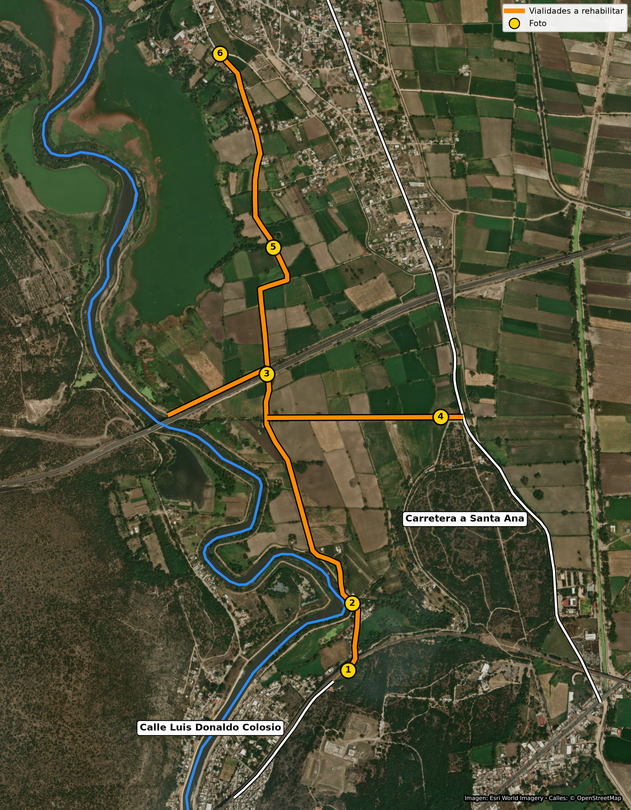
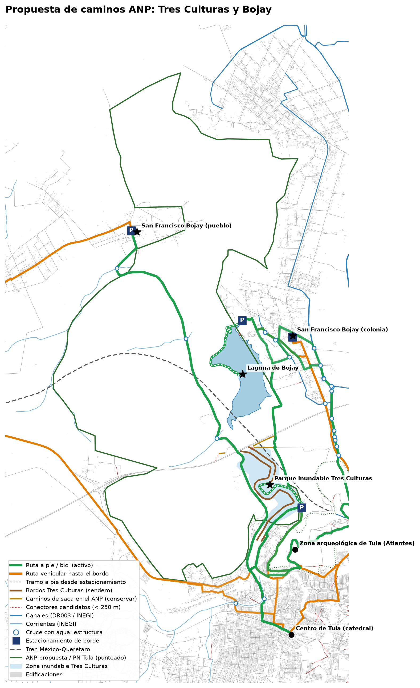

# Propuesta de caminos ANP

Caminos para llegar a **Tres Culturas** y a **Bojay** dentro de la propuesta de APFF Corredor biocultural Tres Culturas (1,493 ha), con tres condiciones:

1. **No incentivar la urbanización** dentro del ANP.
2. **Apoyar las actividades económicas** del sitio: agricultura, ganadería, turismo de naturaleza y comercio en Bojay y La Malinche.
3. **Respetar drenes agrícolas y canales**: no ocupar su zona federal y resolver cada cruce con una estructura.

## Solicitudes del ejido de San Francisco Bojay

El 20 de noviembre de 2026 el ejido entregó los caminos que necesita (KMZ con 9 puntos fotografiados).



Mapa de la nota conceptual: solo las vialidades a rehabilitar (rehabilitación de caminos, camino a parcelas hasta la carretera a Santa Ana y acceso vehicular al bordo), las calles con las que conectan y las fotos 1–6. Para la versión editable (`dibujo_ejido.py`) el fondo es la imagen Esri Wayback del 31 ago 2022, con la laguna sin lirio, y una flecha indica hacia dónde queda la estación Tula del Tren México–Querétaro (~2.5 km por calles locales desde el extremo sur de la carretera a Santa Ana).

| Solicitud | km | En ANP | Sobre camino existente | Canales DR003 |
|---|---|---|---|---|
| Andador peatonal | 4.7 | 4.1 km | Bordos | A 16 m, sin cruce |
| Rehabilitación de caminos | 3.0 | 0.55 km | 98% | A 20 m, sin cruce |
| Camino a parcelas | 1.4 | 0 | 65% | **Cruza 1 canal**: requiere alcantarilla o puente |
| Acceso vehicular al bordo | 0.5 | 0.5 km | No | A 30 m, sin cruce |
| Bache | Punto | No | Calle urbana | — |

Encaje con la propuesta:

- El andador y la rehabilitación coinciden con las rutas a pie de este análisis (2.1 y 2.9 km).
- El camino a parcelas queda fuera del ANP y apoya la actividad agrícola.
- El acceso vehicular al bordo es el único camino nuevo dentro del ANP. Se propone como camino tipo B: terracería de 4 m como máximo, pluma del ejido y sin servicios.
- Con base en esto se prepararon una nota conceptual, una carta del Comisariado al gobernador y un oficio al presidente municipal (no están en el repo).

## Análisis de rutas



Mapa interactivo con satélite: [`resultados/mapa_interactivo.html`](resultados/mapa_interactivo.html) (descargar y abrir en el navegador).

### Idea central: estacionarse en el borde, caminar o pedalear adentro

| Tipo | Usuarios | Dónde | Superficie | Control |
|---|---|---|---|---|
| **A. Sendero / ciclovía** | Peatones, bicis | Sobre bordos existentes (Tres Culturas y perímetro de Bojay), barranca PN Tula–Tres Culturas | Terracería compactada o permeable, sin asfalto | Bolardos removibles en cada entrada |
| **B. Camino de saca y servicio** | Ejidatarios, ganado, emergencias, mantenimiento | Brechas agrícolas existentes dentro del ANP | Terracería existente, solo mantenimiento | Pluma o candado del ejido; sin ampliación |
| **C. Acceso vehicular de borde** | Visitantes en auto | Calles existentes hasta el límite urbano | Lo que ya existe | Termina en un estacionamiento de borde |

El análisis no requiere ningún camino vehicular nuevo dentro del ANP; la única excepción es el acceso al bordo que pidió el ejido para llegar a sus parcelas.

### Resultados

Rutas de menor costo sobre la red existente (OSM + bordos), con conectores nuevos de hasta 250 m solo para peatones. Detalle en [`resultados/rutas_resumen.csv`](resultados/rutas_resumen.csv).

| Modo | Origen | Destino | km | km bordo | km nuevo | km zona inundable | km riesgo urbanización | Cruces con agua |
|---|---|---|---|---|---|---|---|---|
| A pie / bici | Centro | Tres Culturas | 3.6 | 1.7 | 0.04 | 1.7 | 0 | 1 |
| Auto → borde | Centro | Tres Culturas | 2.3 + 1.1 a pie | — | 0 | 0 | 0 | 0 |
| A pie / bici | Zona arqueológica | Tres Culturas | 3.4 | 1.0 | 0 | 1.1 | 0 | 0 |
| A pie / bici | Centro | Laguna de Bojay | 7.4 | 2.5 | 0.10 | 1.0 | 0 | 1 |
| Auto → borde | Centro | Laguna de Bojay | 6.3 + 1.6 a pie | — | 0 | 0 | 0 | 4 |
| A pie / bici | Centro | SF Bojay (colonia) | 6.0 | 1.0 | 0.06 | 1.0 | 0 | 2 |
| A pie / bici | Centro | SF Bojay (pueblo) | 7.6 | 0 | 0 | 0.1 | 0 | 4 |
| Auto | Centro | SF Bojay (pueblo) | 11.7 | — | 0 | 0 | 0 | 1 |

**km riesgo urbanización**: km de ruta vehicular dentro del ANP en suelo no urbano, donde mejorar el acceso en auto atraería lotificación.

Hallazgos:

- **Ninguna ruta vehicular necesita entrar al ANP** (riesgo de urbanización = 0 km). Basta con 4 estacionamientos de borde: sureste de Tres Culturas (1.1 km a pie hasta el parque), norte de la laguna de Bojay (1.6 km), colonia Bojay y pueblo Bojay.
- **Los bordos ya son el sendero.** De Centro a Tres Culturas, el 47% del recorrido va sobre bordo; a la laguna de Bojay, 2.5 km. Coincide con la ciclovía Tula–Bojay del recorrido de noviembre de 2025.
- **Casi no hace falta construir.** Los conectores nuevos en las rutas suman menos de 150 m. Hay 9.1 km de conectores candidatos en el área, 1.2 km de ellos dentro del ANP o a menos de 300 m.
- **El punto de tensión es Tula – SF Bojay (pueblo).** A pie se cruza el ANP por 3.9 km de brecha rural (7.6 km); en auto se rodea (11.7 km). Esa brecha debe quedar como **camino tipo B**: sin pavimentar y con acceso restringido. Si se pavimenta, se vuelve el eje de urbanización del cerro.
- **27 cruces con canales o corrientes** en las rutas (24 en rutas a pie). Cada uno necesita una alcantarilla o puente que no reduzca la sección hidráulica. El grupo sobre el camino a la colonia Bojay probablemente es un desfase entre el canal DR003 y el camino OSM, que corren paralelos; hay que verificarlo en campo.
- **Caminos de saca**: 1.2 km de brechas dentro del ANP dan servicio directo a parcelas. Se conservan como tipo B.

## Metodología e investigación

- [`docs/metodologia.md`](docs/metodologia.md): cómo se hacen estos procesos (marco legal, pasos, criterios técnicos) y cómo se modeló aquí.
- [`docs/criterios_diseno.md`](docs/criterios_diseno.md): reglas para no inducir urbanización y para respetar drenes y canales.
- [`docs/guion_ppt.md`](docs/guion_ppt.md): guion lámina por lámina para la presentación.

## Archivos

| Archivo | Contenido |
|---|---|
| `datos/capas.gpkg` | Capas base recortadas (EPSG:32614): ANP, PN Tula, zona inundable, laguna, bordos, canales DR003 e INEGI, corrientes, edificios, parcelas RAN y de zona federal, colectores, OSM |
| `datos/puntos.csv` | Orígenes y destinos (editable). La **estación del tren** está pendiente de coordenada |
| `datos/osm.json` | Descarga de OpenStreetMap (Overpass, 18 nov 2026) |
| `preparar_capas.py` | Arma `capas.gpkg` desde la carpeta SEMARNAT |
| `red_y_rutas.py` | Red, costos por modo, rutas, estacionamientos de borde, cruces y caminos de saca |
| `mapa.py` | Mapa PNG e interactivo HTML |
| `datos/ejidatarios.gpkg` | Caminos y bache solicitados por el ejido (KMZ del 20 nov 2026) |
| `datos/fotos_puntos.csv` | Número, archivo y ubicación de cada foto del recorrido |
| `mapa_ejido.py` | Mapa satelital de la nota: vialidades a rehabilitar, calles de conexión y fotos 1–6 |
| `dibujo_ejido.py` | El mismo mapa como PowerPoint editable (figuras sobre imagen de 2022) con la flecha a la estación del tren |
| `nota_caminos.py` | Nota conceptual en Word con tabla, mapa y fotos (las fotos no están en el repo) |
| `resultados/red.gpkg` | Capas `red`, `rutas`, `estacionamientos_borde`, `cruces_agua`, `caminos_saca`, `conectores_candidatos` |

## Uso

```
pip install -r requirements.txt
python preparar_capas.py "D:/03_Trabajo/01_SEMARNAT" datos/osm.json D:/bordos-tres-culturas/datos/bordos.gpkg datos/capas.gpkg
python red_y_rutas.py datos/capas.gpkg datos/puntos.csv resultados
python mapa.py datos/capas.gpkg datos/puntos.csv resultados
python mapa_ejido.py datos/capas.gpkg datos/ejidatarios.gpkg datos/fotos_puntos.csv "-" resultados/mapa_caminos_ejido.png
python dibujo_ejido.py datos/capas.gpkg datos/ejidatarios.gpkg datos/fotos_puntos.csv documentos/mapa_editable.pptx
python nota_caminos.py resultados/mapa_caminos_ejido.png datos/fotos_puntos.csv <carpeta_fotos> documentos/nota.docx
```

Los parámetros de costo (`ACTIVO`, `VEHICULAR`, `CASTIGO_ANP_RURAL`, etc.) están al inicio de `red_y_rutas.py`.

## Pendientes y limitaciones

- **Estación del tren México–Querétaro**: la prensa la ubica en la colonia El Llano (Publimetro, Criterio Hidalgo), pero no hay confirmación oficial y el trazo se modificó (Milenio). El mapa solo indica la dirección; falta la coordenada definitiva en `datos/puntos.csv` para calcular rutas.
- **Drenes agrícolas**: no existe una capa; DR003 solo trae canales. Hay que digitalizarlos (ortofoto y recorrido) o derivarlos del MDT del IMTA y sumarlos a `canales`.
- **Bordo Tres Culturas–Bojay bajo el Arco Norte**: no está en `bordos.gpkg`. Quedan ~260 m sin datos entre el fin del bordo y la laguna. Hay que digitalizarlo para que la ruta a Bojay use la ciclovía continua.
- **Sendero de la barranca** PN Tula–Tres Culturas: no está en OSM. Hay que levantarlo con GPS.
- Zona inundable: los senderos tipo A pueden inundarse cada 3–5 años según la propuesta del parque. Se aceptan como estacionales; nada vehicular entra ahí.
- Fuente de caminos: OSM. Datos © colaboradores de OpenStreetMap, ODbL.
